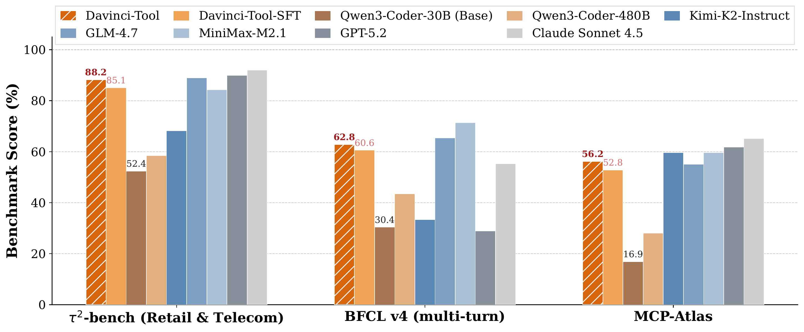
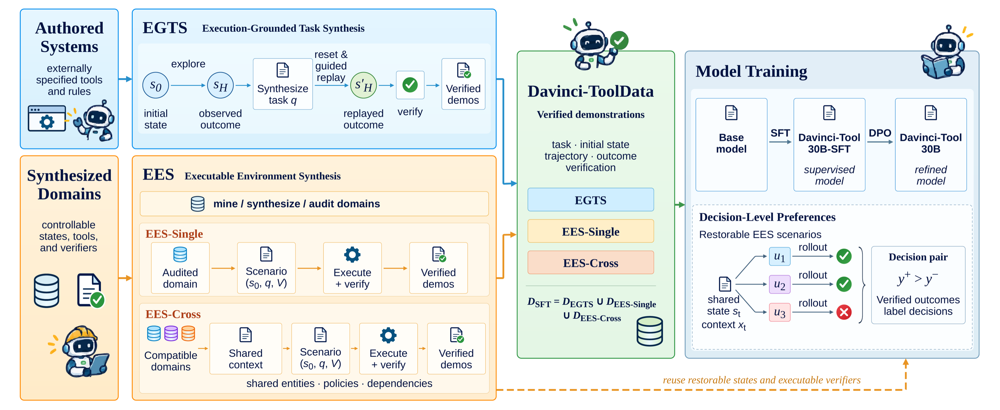

# Davinci-Tool: Scaling Agentic Tool-Use Supervision with Verifiable Executable Environments

<p align="center">
  📄 <a href="https://arxiv.org/abs/XXXX.XXXXX">Paper</a> ·
  🤗 <a href="https://huggingface.co/SII-Enigma/Davinci-Tool-30B">Davinci-Tool-30B</a> ·
  🤗 <a href="https://huggingface.co/SII-Enigma/Davinci-Tool-30B-SFT">Davinci-Tool-30B-SFT</a> ·
  🤗 <a href="https://huggingface.co/datasets/SII-Enigma/Davinci-ToolData">Davinci-ToolData</a>
</p>

**Davinci-Tool** is a 30B-parameter (3B activated) tool-use model, and **Davinci-ToolData** is an
execution-grounded dataset of **30,395 verified trajectories** spanning **2,260 invoked tools**.
Every trajectory is accepted only after its outcome is checked against executable evidence.
Davinci-Tool improves Qwen3-Coder-30B-A3B-Instruct from 52.4 to **88.2** on τ²-bench, from 30.4 to
**62.8** on BFCL v4 multi-turn, and from 16.9 to **56.2** on MCP-Atlas, outperforming
Qwen3-Coder-480B-A35B-Instruct on all three benchmarks with 1/16 of its total parameters.

<p align="center">
  
</p>
<p align="center"><em>Performance on τ²-bench, BFCL v4 multi-turn, and MCP-Atlas. Davinci-Tool-30B (after DPO) is hatched; its SFT checkpoint is shown for comparison.</em></p>

## Method

<p align="center">
  
</p>
<p align="center"><em>Construction of Davinci-ToolData and training of Davinci-Tool.</em></p>

Davinci-ToolData is built by two complementary pipelines that share one execution and verification
interface:

- **EGTS — Execution-Grounded Task Synthesis** (authored systems). An explorer interacts with a
  resettable executable world; user tasks are synthesized *from* the recorded outcome; the world is
  reset and the task is replayed with a guide, and the replay is accepted only if it recovers the
  explored outcome. Structural checks, a hard factual judge, and a soft quality judge filter the
  results. EGTS covers 11 authored environments, including ToolSandbox, API-Bank, StableToolBench,
  MCPMark, Terminal-Bench, WebShop, ScienceWorld, Toolathlon, and AppWorld.
- **EES — Executable Environment Synthesis** (synthesized systems). Audited executable domains
  (191 domains in 19 categories) produce state-grounded tasks with executable verifiers within one
  domain (**EES-Single**), and are composed into shared multi-domain worlds (246 compositions) with
  shared entities, linking fields, cross-domain policies, and coherence constraints (**EES-Cross**).

Training has two stages: **SFT** on the verified demonstrations, then **decision-level DPO**, which
reuses restorable states and executable verifiers to fork the SFT policy at decision points, execute
alternative actions from the same state, and keep pairs whose verified downstream outcomes differ
(1,150 pairs).

## Main results

| Model | τ²-bench Retail | τ²-bench Telecom | τ²-bench Avg. | BFCL v4 MT Avg. | MCP-Atlas |
|---|---:|---:|---:|---:|---:|
| Qwen3-Coder-480B-A35B-Instruct | 77.5 | 39.5 | 58.5 | 43.5 | 28.1 |
| Kimi-K2-Instruct | 70.6 | 65.8 | 68.2 | 33.4 | 59.6 |
| MiniMax-M2.1 | 81.6 | 87.0 | 84.3 | 71.4 | 59.6 |
| GLM-4.7 | 79.8 | 98.2 | 89.0 | 65.4 | 55.1 |
| GPT-5.2 | 81.6 | 98.2 | 89.9 | 28.9 | 61.8 |
| Claude-Sonnet-4.5 | 86.0 | 98.0 | 92.0 | 55.3 | 65.2 |
| Qwen3-Coder-30B-A3B-Instruct | 68.7 | 36.0 | 52.4 | 30.4 | 16.9 |
| + Toucan-1.5M SFT | 65.8 | 89.5 | 77.7 | 41.9 | 22.5 |
| + Davinci-ToolData SFT (**Davinci-Tool-30B-SFT**) | 73.7 | 96.5 | 85.1 | 60.6 | 52.8 |
| + SFT + DPO (**Davinci-Tool-30B**) | **79.8** | **96.5** | **88.2** | **62.8** | **56.2** |

All scores are from the authors' evaluations under the official protocols; MCP-Atlas uses the 89
tasks that do not require external API keys. Under the same backbone and SFT hyperparameters,
Davinci-ToolData exceeds the public Toucan-1.5M release by 7.4 / 18.7 / 30.3 points.

**Transfer to smaller models** (SFT on Davinci-ToolData):

| Model | τ²-bench Avg. | BFCL v4 MT Avg. |
|---|---:|---:|
| Qwen3-8B → + Davinci-ToolData | 32.5 → **74.6** | 15.4 → **33.9** |
| Qwen3-14B → + Davinci-ToolData | 33.4 → **76.8** | 21.1 → **41.4** |

**Data sources are complementary** (SFT on Qwen3-Coder-30B-A3B-Instruct):

| EGTS | EES-Single | EES-Cross | τ²-bench | BFCL v4 | MCP-Atlas |
|:---:|:---:|:---:|---:|---:|---:|
| ✓ | | | 78.9 | 57.4 | 28.1 |
| | ✓ | | 82.0 | 54.5 | 29.2 |
| | | ✓ | 83.4 | 46.6 | 47.2 |
| ✓ | ✓ | | 79.4 | 57.6 | 31.5 |
| | ✓ | ✓ | 82.9 | 55.6 | 50.6 |
| ✓ | ✓ | ✓ | **85.1** | **60.6** | **52.8** |

## Davinci-ToolData

| Source | Trajectories | Mean tokens | Mean tool calls | Distinct invoked tools |
|---|---:|---:|---:|---:|
| EGTS | 13,824 | 10,063.9 | 6.04 | 350 |
| EES-Single | 8,026 | 10,372.7 | 5.87 | 1,610 |
| EES-Cross | 8,545 | 20,444.7 | 7.01 | 1,683 |
| **Total** | **30,395** | 13,063.8 | 6.26 | 2,260 |

Each example is one JSON line in the standard chat format:

```json
{"messages": [{"role": "system", "content": "..."},
              {"role": "user", "content": "..."},
              {"role": "assistant", "content": "...", "tool_calls": [...]},
              {"role": "tool", "content": "..."}],
 "tools": [...]}
```

## Reproduction

### Installation

```bash
git clone https://github.com/MassLab-SII/Davinci-Tool.git && cd Davinci-Tool
python -m venv .venv && source .venv/bin/activate
pip install -r requirements.txt     # EGTS
pip install -e .                    # EES (use '.[llm]' for model-backed generation)
cp .env.example .env                # OpenAI-compatible model endpoints and optional credentials
```

All commands run from the repository root.

### EGTS

> **Note:** the executable environments (EGTS worlds and EES domain catalogs) are not included in
> this release and will be released later. The pipeline code, prompts, skills, configs, and
> launchers below are complete; collection runs once a world is served at the endpoint set in its
> config.

Requires Docker and an OpenAI-compatible endpoint (Davinci-ToolData used DeepSeek-V4-Pro).

```bash
# 1. Serve an executable world (environments to be released)

# 2. Explore and collect grounded raw trajectories
bash scripts/egts/run_tool_sandbox.sh          # or scripts/egts/run_multi_worlds.sh

# 3. Synthesize tasks from outcomes, replay, verify, and judge
bash scripts/egts/run_synthesis.sh

# 4. Export accepted demonstrations as SFT data
bash scripts/egts/convert.sh
```

Per-world configs are in [`configs/egts/`](configs/egts). See [docs/egts.md](docs/egts.md) for all
launchers and [docs/environments.md](docs/environments.md) for the list of worlds.

### EES

Runs fully offline by default; model-backed context generation, judging, scenarios, and rollouts are
optional. The input is a catalog of executable domains in the format of
[docs/ees-catalog-schema.md](docs/ees-catalog-schema.md) (EES domain catalogs are to be released).

```bash
cross-domain-scaling validate path/to/catalog.json
cross-domain-scaling build path/to/catalog.json --output artifacts/demo \
  --count 5 --seed 17 --scenarios-per-environment 1 --rollout-mode reference
cross-domain-scaling inspect artifacts/demo/bundle.json
```

See [docs/ees.md](docs/ees.md). This repository contains the cross-domain composition and verification stage (EES-Cross).

### Training settings

| Setting | SFT | DPO |
|---|---|---|
| Initialization | Qwen3-Coder-30B-A3B-Instruct | SFT checkpoint (also the frozen reference) |
| Learning rate / schedule | 1e-5, cosine, no warmup | 5e-6, cosine, 3% warmup |
| Epochs | 4 | 1 |
| Max sequence length | 32,768 | 24,576 |
| Batch per device × grad. accum. | 1 × 4 | 1 × 4 |
| Other | assistant-token loss, sample packing, BF16, ZeRO-3 | β = 1.0, precomputed reference log-probs |

## Repository layout

```
Davinci-Tool/
├── src/
│   ├── egts/              EGTS pipeline: data_collection, data_synthesis, prompts, skills
│   └── ees/               EES-Cross package (cross_domain_scaling)
├── configs/
│   └── egts/              per-world collection configs and the synthesis config
├── scripts/
│   └── egts/              launchers for collection, synthesis, and SFT export
├── docs/                  user guides (environments: to be released)
├── figures/               figures used in this README
├── tests/{egts,ees}/
├── requirements.txt       EGTS dependencies
├── pyproject.toml         EES package and the `cross-domain-scaling` CLI
└── .env.example
```

## License

The code is released under the [MIT License](LICENSE). Third-party environments and upstream assets
used by EGTS keep the licenses of their original projects.

## Citation

```bibtex
@article{yuan2026davincitool,
  title   = {Davinci-Tool: Scaling Agentic Tool-Use Supervision with Verifiable Executable Environments},
  author  = {Yuan, Xiaoyang and Zhao, Ji and Hu, Xingyu and Wang, Wenhan and Hu, Yutao and Bin, Yi and Shao, Wenqi and Zhang, Qiaosheng and Liu, Pengfei and Qiao, Yu},
  journal = {arXiv preprint arXiv:XXXX.XXXXX},
  year    = {2026}
}
```
